# codex-phone

[简体中文](README.zh-CN.md) · [Agent setup](docs/agent-setup.md) · [Troubleshooting](docs/troubleshooting.md)

Continue an **existing Codex Desktop conversation from an Android phone**, then return to the same conversation on your computer. Execution, tools, files and account login remain on the computer. The phone is a paired client of your own installation; it does not sign in to ChatGPT.

This is an **unofficial, self-hosted companion**, not an OpenAI product. It uses an internal Desktop interface, which can change between releases. v0.1.0 is a prerelease; check the [compatibility and acceptance record](docs/compatibility.md) before installing. A running relay or an open port does not prove native conversations work.

## What it provides

- A Windows launcher and local Node Agent for native Desktop conversations, messages, streaming events and supported approval requests.
- A generic Android WebView app: pair once, credentials encrypted with Android Keystore, reconnect and restore the last conversation.
- One-use pairing codes, hashed server credentials, authenticated HTTP and WebSocket connections, and revocation of active phone connections.
- A complete Cloudflare Worker + KV + tunnel provider, or your own HTTPS/WSS reverse proxy.
- Idempotent setup, structured diagnostics and management commands. No shared hosted service, shared account or maintainer gateway.

The first UI scope is Windows 11 x64 + Android, one computer and one phone. There is no device-count lock. Multiple-computer selection, other desktop platforms, and migration that preserves phone authorization are not provided. Upstream terminal, independent providers, standalone CLI execution and automation features are outside this companion's scope and are blocked at the gateway.

## How it works

```mermaid
flowchart LR
  Phone[Android app] -->|HTTPS and authenticated WSS| Relay[Your HTTPS relay]
  Relay -->|Tunnel or reverse proxy| Gateway[Authenticated loopback gateway]
  Gateway --> UI[Pinned MIT upstream UI and server]
  UI -->|Agent protocol v1, local secret| Agent[Local Node Agent]
  Agent -->|Loopback CDP| Desktop[Official Codex Desktop]
  Desktop --> Files[Your account, tools and project files]
```



The desktop debugging interface is loopback-only and is **never** published by the tunnel. The public gateway authenticates every business request regardless of the `Host` header. Its private control and Agent endpoint use separate secrets. The relay terminates TLS and can see traffic: this is not end-to-end encryption against your relay operator. See [architecture and privacy](docs/architecture.md).

## Install with your AI agent

Requirements: Windows 11 x64, Node **24.16.0 or newer**, Git, the official Codex Desktop app installed and signed in, Android API 26+ with a modern system WebView. End users download the APK; they do not need Android build tools. A Cloudflare account is optional if you already have an HTTPS/WSS reverse proxy.

Give your local AI agent this request:

> Deploy https://github.com/SunS1eep1ng/codex-phone for me. Read AGENTS.md and docs/agent-setup.md. Use my installed Codex Desktop and separate private state. Diagnose before changing anything. Help me choose Cloudflare or my own HTTPS relay, then run doctor and guide phone pairing. Do not buy services, change system DNS/proxy, force-close Desktop, or substitute standalone CLI conversations.

Manual preparation in PowerShell:

```powershell
git clone https://github.com/SunS1eep1ng/codex-phone.git
Set-Location codex-phone
.\scripts\Install.ps1
```

Setup creates only dedicated **Codex Phone** and **Codex Phone Pair** Start-menu shortcuts. It does not replace the official application shortcut. The checkout is the installation's code directory: keep it in a stable location or rerun setup after moving it. Private state is in `%LOCALAPPDATA%\codex-phone`, outside Git. Use `CODEX_PHONE_STATE` or `--state` to isolate another installation.

### Choose a relay

**Cloudflare** — authorize your own account interactively, then deploy:

```powershell
npx wrangler login
npx wrangler whoami
node dist/cli.mjs relay cloudflare deploy --account YOUR_ACCOUNT_ID
```

Deployment creates your own Worker and KV namespace; secrets/configuration are generated in private state. A managed cloudflared Quick Tunnel publishes the authenticated gateway, and the Worker stores its current origin. The fixed Worker address stays the same after tunnel rotation. Quick Tunnels have no availability guarantee; do not assume a production SLA. [Cloudflare details](docs/relay.md).

**Existing HTTPS relay** — configure an HTTPS origin that forwards HTTP and WSS to the gateway's saved loopback port:

```powershell
node dist/cli.mjs setup --endpoint https://YOUR_GATEWAY
```

The external reverse proxy is maintained by you. It must forward cookies, WebSocket upgrades and errors without caching; do not expose the control/CDP ports. An [nginx example and interface contract](docs/relay.md) are provided.

### Start, diagnose, pair

```powershell
node dist/cli.mjs start
node dist/cli.mjs doctor --json
node dist/cli.mjs pair --open
```

If Desktop is already running without its debugging interface, **exit it normally once, including the tray icon**. The companion waits and reopens the official app. Never force-close it or reopen it manually during this handoff. Subsequent launches through **Codex Phone** reuse the running instance; the companion recovers components while it remains running. Starting the original official shortcut after stopping everything may require another normal exit. Windows logon startup is not installed.

Download the signed APK and its SHA-256 file from [Releases](https://github.com/SunS1eep1ng/codex-phone/releases). Verify the checksum, install, then enter your gateway address and the 8-digit code from the private pairing page, or paste its pairing link. Codes expire after 10 minutes and work once. Never share the page or its code. The public app ID is `io.github.suns1eep1ng.codexphone`; development builds use `.dev`.

On the phone, open an existing conversation and send a harmless test message. Confirm the same reply on Desktop. Close/reopen the APK, test on mobile data, and test a permission approval separately. Passing automated mock tests is not a substitute for those checks.

## Manage

```powershell
node dist/cli.mjs status --json
node dist/cli.mjs doctor --json
node dist/cli.mjs phones list --json
node dist/cli.mjs phones revoke PHONE_ID
node dist/cli.mjs relay check --json
node dist/cli.mjs stop
node dist/cli.mjs uninstall
```

Results contain `status` (`ok`, `needs_user_action`, `error`), `code`, and relevant `next` actions. Exit codes are 0, 2, 1 respectively. `start` confirms the service started; **doctor** separately checks a real native `thread/list`, relay identity and anonymous HTTP/WSS rejection. Pair output is sensitive even in JSON.

An optional process-local proxy can be set with `setup --proxy http://YOUR_PROXY:PORT`. No proxy address, system setting or DNS change is supplied by default. After changing configuration, use `stop` then `start` to load it.

Upgrade: `stop`, update the checkout, run `scripts/Update.ps1`, then `doctor`. Your state, device identity and authorized phones are retained. Uninstall stops owned local components and removes owned shortcuts/state; cloud resources are a separate explicit deletion. To change computers, deploy again and pair again; migrate Desktop conversations and project files separately.

## Build and verify

```powershell
npm ci
npm run build
npm test
npm run audit:publish
# Explicit, read-only live Desktop check (never closes/restarts it):
npm run test:native -- --allow-desktop-read
```

Default tests use temporary state and mocks, never a user's installation. They cover authentication/Host rewriting/revocation, Agent chunking/deduplication/reconnect, native history and approval forwarding, Windows version selection/occupied ports, child exit codes, and the pinned upstream integration. See [acceptance](docs/compatibility.md) and [Android build/signing](android/README.md). CI builds an **unsigned** APK. Release signing happens locally with a separate project key outside Git and CI.

## Provenance and license

MIT. We reuse the pinned **v0.1.101** source/server/UI and Agent protocol from [YusenDu/codex-remote-bridge](https://github.com/YusenDu/codex-remote-bridge), originally [friuns2/codexui](https://github.com/friuns2/codexui). Archive URLs, versions and SHA-256 values are in [upstream.lock.json](upstream.lock.json). Build-time acquisition verifies them; there are no compiled-string patches or global HTTP hooks.

This project adds the Node native Agent, installation/lifecycle management, authenticated gateway, phone pairing/client, relay providers and deployment guidance. The renderer adapter is an attributed MIT source adaptation. OpenAI Desktop binaries and extracted application JavaScript are not redistributed. See [THIRD_PARTY_NOTICES.md](THIRD_PARTY_NOTICES.md), [SECURITY.md](SECURITY.md) and [release procedure](docs/releasing.md).
