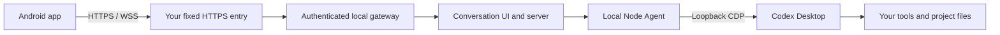

# codex-phone

### Your Codex sessions. Now in your pocket.

[简体中文](README.zh-CN.md) · [Download APK](https://github.com/SunS1eep1ng/codex-phone/releases) · [Agent setup](docs/agent-setup.md) · [Troubleshooting](docs/troubleshooting.md)

**Start at your desk. Continue on your phone. Pick up the same conversation when you return.**

codex-phone brings your existing **Codex Desktop conversations** to Android. Send a follow-up, watch replies arrive, and handle supported tool approvals while your computer runs the work with its existing account, tools and project files.

Pair your phone once, then open the app whenever you want to check in. **Your phone needs no ChatGPT login.**

Windows 11 x64 · Android 8.0+ with a modern WebView · Self-hosted · MIT

## From desk to pocket and back

1. **At your desk:** open **Codex Phone** from the Windows Start menu and start working in Codex.
2. **On the move:** open the paired Android app, choose an existing conversation, and keep going over Wi-Fi or mobile data.
3. **Back at your desk:** return to that same conversation and continue from the work you did on your phone.

For example: ask Codex to investigate a bug on your computer, check its findings from your phone, send “apply the second approach,” and review the resulting changes when you get back.

| What you want to do               | What you get                                                                |
| --------------------------------- | --------------------------------------------------------------------------- |
| Continue work away from your desk | Your existing conversations, with execution on your computer                |
| Send the next instruction         | A chat interface with streaming replies and supported approvals             |
| Open the app again tomorrow       | Saved pairing credentials and the last conversation                         |
| Reach your computer while out     | A fixed HTTPS entry through your own Cloudflare account or reverse proxy    |
| Manage your installation          | Start-menu shortcuts, diagnostics, phone authorization and upgrade commands |

Keep your computer powered on, online, and running the companion. It remains the place where Codex executes your tasks.

## Get connected

### Let your AI agent handle setup

Have Windows 11 x64, Git, Node **24.16.0 or newer**, and a signed-in official Codex Desktop app ready. On your phone, use Android API 26+ with an up-to-date system WebView; install the APK directly from Releases.

Give your local AI agent this request:

> Deploy https://github.com/SunS1eep1ng/codex-phone for me. Read AGENTS.md and docs/agent-setup.md, check my environment, and use my installed Codex Desktop with a separate private state directory. Help me choose Cloudflare or my own HTTPS relay, configure the installation, run doctor, and guide me through phone pairing and continuing the same conversation on both devices.

The agent prepares the installation. You complete account authorization when prompted and install/pair the phone app.

### Or install it yourself

Run in PowerShell:

```powershell
git clone https://github.com/SunS1eep1ng/codex-phone.git
Set-Location codex-phone
.\scripts\Install.ps1
```

Keep this checkout in a stable location: it provides the bootstrap and management entry points. Private settings and phone authorizations live separately in `%LOCALAPPDATA%\codex-phone`.

**Choose your connection.** With Cloudflare, authorize your own account and deploy:

```powershell
npx wrangler login
npx wrangler whoami
node scripts/manage.mjs relay cloudflare deploy --account YOUR_ACCOUNT_ID
```

This creates a Worker and KV namespace in your account. The Worker provides a fixed address while the managed tunnel connects it to your computer and updates its destination when the tunnel address changes.

Already have an HTTPS/WSS reverse proxy? Point it at the gateway's saved loopback port and set your public entry:

```powershell
node scripts/manage.mjs setup --endpoint https://YOUR_GATEWAY
```

See the [relay guide](docs/relay.md) for Cloudflare configuration and an nginx example.

**Start and pair:**

```powershell
node scripts/manage.mjs start --supervise
node scripts/manage.mjs doctor --json
node scripts/manage.mjs pair --open
```

If Codex is already running without the local bridge interface, exit it normally once, including its tray icon. Leave the launcher running; it will reopen Codex with the interface enabled. For everyday use, open **Codex Phone** from the Start menu to launch or reuse the configured instance and start the companion's recovery supervisor.

On Android:

1. Download and install the signed APK from [Releases](https://github.com/SunS1eep1ng/codex-phone/releases). SHA-256 checksums are included with each release.
2. Paste the pairing link, or enter the gateway address and 8-digit code shown on your computer. The private code is single-use and expires after 10 minutes.
3. Open an existing conversation and send a message. Check the same reply on Desktop, then try closing/reopening the app and connecting over mobile data.

Your phone is now your pocket entry to the conversations on that computer.

## Daily use and recovery

Pairing credentials are encrypted with Android Keystore. Reopening the app restores authentication and the last conversation. The companion can reconnect the tunnel and native connection; the supervisor recovers the companion process after an unexpected exit.

After a connection interruption, the recovery flow reads the latest conversation history and pending approvals from Desktop, preserving unsent drafts. If a send's outcome is uncertain, review the computer's record and acknowledge it in the recovery notice before sending the same request again.

| Command                                          | Use it for                                                   |
| ------------------------------------------------ | ------------------------------------------------------------ |
| `node scripts/manage.mjs status --json`          | Current service status                                       |
| `node scripts/manage.mjs doctor --json`          | Desktop conversation access, relay and authentication checks |
| `node scripts/manage.mjs pair --open`            | A fresh pairing page                                         |
| `node scripts/manage.mjs phones list --json`     | Authorized phones                                            |
| `node scripts/manage.mjs phones revoke PHONE_ID` | Revoke a phone and close its active connections              |
| `node scripts/manage.mjs relay check --json`     | Relay health                                                 |
| `node scripts/manage.mjs stop`                   | Stop the companion and its recovery supervisor               |
| `node scripts/manage.mjs uninstall`              | Remove the local installation                                |

**Upgrade:** update the bootstrap checkout, run `scripts/Update.ps1`, then run `doctor`. The installer prepares dependencies, builds and tests the candidate in a separate generation before switching. Failed activation rolls back to the previous generation; device identity and paired phones are retained.

For a process-local network proxy, use `setup --proxy http://YOUR_PROXY:PORT`, then `stop` and `start --supervise` to load the setting. Structured command results include `status`, `code` and relevant `next` actions; see the [deployment guide](docs/agent-setup.md).

## Under the hood



The gateway handles pairing and authenticated HTTP/WebSocket access. The local Node Agent connects the conversation interface to Codex Desktop. Desktop and control interfaces stay on loopback; the public entry routes through the authenticated gateway. Read [architecture and privacy](docs/architecture.md) for the data path, relay trust model and credential handling.

## Build, compatibility and project notes

```powershell
npm ci
npm run build
npm test
npm run audit:publish
```

Tests cover authentication, reconnects, request deduplication, history and approval forwarding, lifecycle recovery and upgrade rollback, using temporary state and simulated services. The [compatibility record](docs/compatibility.md) tracks tested versions and Desktop/phone acceptance separately. The current platform focus is Windows 11 x64 and Android, with one computer and one phone in the primary workflow.

- [AI deployment guide](docs/agent-setup.md): setup order, configuration and management.
- [Troubleshooting](docs/troubleshooting.md): diagnostics and recovery steps.
- [Android build and signing](android/README.md): build the APK yourself; CI produces unsigned builds and release APKs are signed locally.
- [Changelog](CHANGELOG.md): changes and recovery improvements.

codex-phone is an independent, MIT-licensed companion for Codex Desktop. It builds on the pinned **v0.1.101** UI, server and Agent protocol from [YusenDu/codex-remote-bridge](https://github.com/YusenDu/codex-remote-bridge), originally [friuns2/codexui](https://github.com/friuns2/codexui). This project adds the native Node Agent, authenticated gateway, Android pairing client, relay providers, installation and recovery management. Versions and checksums are recorded in [upstream.lock.json](upstream.lock.json); attribution is in [THIRD_PARTY_NOTICES.md](THIRD_PARTY_NOTICES.md).

[MIT license](LICENSE) · [Security](SECURITY.md) · [Release procedure](docs/releasing.md)
