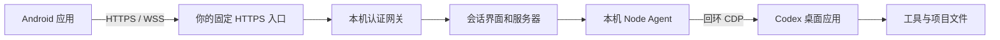

# codex-phone

### 电脑里的 Codex，装进口袋。

[English](README.md) · [下载 APK](https://github.com/SunS1eep1ng/codex-phone/releases) · [AI 部署指南](docs/agent-setup.zh-CN.md) · [排错](docs/troubleshooting.zh-CN.md)

**电脑上开个头，手机上接着聊，回到桌前继续同一条会话。**

codex-phone 把你已有的 **Codex 桌面会话**带到 Android 手机。出门后补一句需求、看看实时回复、处理支持的工具审批；电脑继续使用原有账号、工具和项目文件执行任务。

首次配对后，点开手机应用就能继续。**手机无需登录 ChatGPT。**

Windows 11 x64 · Android 8.0+ 与较新的系统 WebView · 自行部署 · MIT 开源

## 从桌前出发，在手机上继续

1. **在电脑前：**从开始菜单打开 **Codex Phone**，照常在 Codex 中开始工作。
2. **出门之后：**打开已配对的 Android 应用，选中已有会话，用 Wi-Fi 或移动数据继续发消息。
3. **回到桌前：**打开同一条会话，接着手机上推进的工作往下做。

比如：出门前让 Codex 排查一个 bug，路上用手机查看分析，补一句“按第二个方案修改”，回到电脑时接着检查代码变更。

| 你想做的事             | 用起来是什么样                                      |
| ---------------------- | --------------------------------------------------- |
| 离开电脑后继续推进工作 | 打开已有会话，任务仍在你的电脑上执行                |
| 随时补一句需求         | 聊天界面、流式回复，以及支持的权限审批              |
| 明天再打开应用         | 恢复已保存的配对授权和上次会话                      |
| 外出时找到自己的电脑   | 通过自有 Cloudflare 或反向代理的固定 HTTPS 入口连接 |
| 管理整套服务           | 专用开始菜单入口、诊断、手机授权及升级命令          |

使用时让电脑保持开机、联网，并运行接入服务。Codex 在这台电脑上完成实际工作。

## 开始连接

### 让 AI agent 帮你部署

电脑准备好 Windows 11 x64、Git、Node **24.16.0 或更高版本**，以及已经登录的官方 Codex 桌面应用。手机需要 Android API 26+ 和较新的系统 WebView，直接从 Releases 安装 APK 即可。

把这段发给电脑上的 AI agent：

> 帮我部署 https://github.com/SunS1eep1ng/codex-phone 。阅读 AGENTS.md 和 docs/agent-setup.zh-CN.md，检查环境，复用我已安装的官方 Codex 桌面应用，使用独立私有状态目录。按我的网络环境选择 Cloudflare 或自有 HTTPS 中转，完成配置、执行 doctor，并引导我配对手机，验证两端能继续同一条会话。

Agent 负责准备安装和配置；需要账号授权时由你完成，最后在手机上安装并配对。

### 也可以自己安装

在 PowerShell 运行：

```powershell
git clone https://github.com/SunS1eep1ng/codex-phone.git
Set-Location codex-phone
.\scripts\Install.ps1
```

把仓库放在固定位置，它提供安装引导和管理入口。私有配置与手机授权另外保存在 `%LOCALAPPDATA%\codex-phone`。

**选择连接方式。** 使用 Cloudflare 时，登录你自己的账号并部署：

```powershell
npx wrangler login
npx wrangler whoami
node scripts/manage.mjs relay cloudflare deploy --account YOUR_ACCOUNT_ID
```

命令会在你的账号下创建 Worker 和 KV。Worker 提供固定入口，项目管理的隧道负责连接电脑；隧道地址改变后，入口自动更新目标，手机继续使用原来的地址。

已有 HTTPS／WSS 反向代理时，将它指向配置中保存的网关回环端口，再设置公开入口：

```powershell
node scripts/manage.mjs setup --endpoint https://YOUR_GATEWAY
```

Cloudflare 配置和 nginx 示例见[中转指南](docs/relay.md)。

**启动并配对：**

```powershell
node scripts/manage.mjs start --supervise
node scripts/manage.mjs doctor --json
node scripts/manage.mjs pair --open
```

如果 Codex 已运行但没有启用本机桥接接口，首次配置时正常退出一次，包括托盘图标。让启动器保持运行，它会自动重新打开已启用接口的 Codex。之后日常从开始菜单打开 **Codex Phone**，即可启动或复用已配置的实例，同时启用接入服务的恢复守护。

在 Android 手机上：

1. 从 [Releases](https://github.com/SunS1eep1ng/codex-phone/releases) 下载并安装签名 APK；每个发行版附有 SHA-256 校验值。
2. 粘贴配对链接，或输入电脑配对页上的入口地址与 8 位配对码。配对码仅供本人使用，10 分钟有效、只能使用一次。
3. 打开已有会话发一条消息，在电脑上查看同一条回复，再试一次关闭重开应用和移动数据连接。

配对完成，这部手机就是你随身的 Codex 会话入口。

## 日常使用与恢复

手机凭证由 Android Keystore 加密保存，重开应用会恢复认证和上次会话。接入服务负责隧道与原生连接的重连；守护进程会在接入服务意外退出后恢复它。

连接中断后，恢复流程从桌面端读取最新历史与待审批事项，并保护尚未发送的草稿。某次发送结果不确定时，先核对电脑上的记录，再在恢复提示中确认，之后再决定是否重新发送同一请求。

| 命令                                             | 用途                         |
| ------------------------------------------------ | ---------------------------- |
| `node scripts/manage.mjs status --json`          | 查看服务状态                 |
| `node scripts/manage.mjs doctor --json`          | 检查桌面会话访问、中转及认证 |
| `node scripts/manage.mjs pair --open`            | 打开新的配对页               |
| `node scripts/manage.mjs phones list --json`     | 查看已授权手机               |
| `node scripts/manage.mjs phones revoke PHONE_ID` | 撤销手机授权并断开其现有连接 |
| `node scripts/manage.mjs relay check --json`     | 检查中转健康状态             |
| `node scripts/manage.mjs stop`                   | 停止接入服务及恢复守护       |
| `node scripts/manage.mjs uninstall`              | 卸载本地安装                 |

**升级：**更新安装引导所用的仓库，运行 `scripts/Update.ps1`，再执行 `doctor`。安装器先在独立目录准备候选版本的依赖、构建和测试，再切换运行版本；激活失败时回退旧版本，设备身份与已配对手机会保留。

需要进程级网络代理时，使用 `setup --proxy http://YOUR_PROXY:PORT`，再通过 `stop` 和 `start --supervise` 加载设置。命令的结构化结果包含 `status`、`code` 和相关 `next` 操作，详见[部署指南](docs/agent-setup.zh-CN.md)。

## 工作原理



网关负责配对及 HTTP／WebSocket 认证，本机 Node Agent 将手机会话界面接入 Codex 桌面应用。桌面接口和管理接口监听本机回环，公开入口经由认证网关转发。[架构与隐私](docs/architecture.md)介绍了数据路径、中转信任关系和凭证管理。

## 开发、兼容与项目资料

```powershell
npm ci
npm run build
npm test
npm run audit:publish
```

测试使用临时状态和模拟服务，覆盖认证、重连、请求去重、历史与审批转发、生命周期恢复及升级回退。[兼容记录](docs/compatibility.md)分别列出已测试版本和桌面／手机实机验收情况。当前主要使用流程面向 Windows 11 x64 与 Android，一台电脑配一部手机。

- [AI 部署指南](docs/agent-setup.zh-CN.md)：安装顺序、配置与管理。
- [排错指南](docs/troubleshooting.zh-CN.md)：诊断与恢复步骤。
- [Android 构建与签名](android/README.md)：自行构建 APK；CI 生成未签名构建，发行 APK 在本地签名。
- [更新记录](CHANGELOG.md)：版本变化与恢复机制改进。

codex-phone 是采用 MIT 许可证的独立 Codex 桌面配套项目。它复用 [YusenDu/codex-remote-bridge](https://github.com/YusenDu/codex-remote-bridge) 固定 **v0.1.101** 的界面、服务器和 Agent 协议，原始项目为 [friuns2/codexui](https://github.com/friuns2/codexui)。本项目新增原生 Node Agent、认证网关、Android 配对客户端、中转提供者，以及安装与恢复管理。版本和校验值见 [upstream.lock.json](upstream.lock.json)，来源说明见 [THIRD_PARTY_NOTICES.md](THIRD_PARTY_NOTICES.md)。

[MIT 许可证](LICENSE) · [安全说明](SECURITY.md) · [发布流程](docs/releasing.md)
