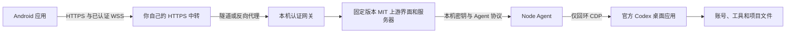

# codex-phone

[English](README.md) · [AI 部署指南](docs/agent-setup.zh-CN.md) · [排错](docs/troubleshooting.zh-CN.md)

在 Android 手机上继续**电脑官方 Codex 桌面应用中的已有会话**，回到电脑后继续同一条记录。执行、工具、项目文件和账号登录仍由电脑负责。手机配对的是你自己部署的接入层，无需登录 ChatGPT。

这是**非官方、自行部署的配套工具**，与 OpenAI 没有官方关联。它依赖可能随更新变化的桌面内部接口。v0.1.0 为预发行版，安装前请看[兼容与验收记录](docs/compatibility.md)。中转可达或端口打开，均不代表原生会话已经可用。

## 首版能力

- Windows 专用启动入口、本机 Node Agent，接入原生桌面会话、消息、流式事件与支持的权限审批。
- 通用 Android WebView 应用：首次配对、Android Keystore 加密凭证、自动认证、重连及恢复上次会话。
- 一次性配对码、服务器只存凭证哈希，HTTP／WebSocket 统一认证，撤销授权会断开现有连接。
- 完整 Cloudflare Worker＋KV＋隧道方案，也能接入自有 HTTPS／WSS 反向代理。
- 幂等安装、结构化诊断与管理命令。每位用户使用自己的电脑、账号与中转，没有共享托管服务或维护者服务器。

首版界面与验收范围为 Windows 11 x64＋Android、一台电脑＋一部手机，没有设备数量锁。暂不提供多电脑选择、其他桌面平台或保留授权的一键换机。上游的独立模型供应商、单独 CLI 执行、终端与自动化功能不属于本项目范围，网关会拒绝这些入口。

## 工作原理



桌面调试接口只监听本机回环，**不会暴露给中转**。网关检查每个业务请求的授权，不因 `Host` 被改成 localhost 而绕过。私有管理接口和 Agent 另用独立密钥。中转会终止 TLS、能够看到流量，因此这里没有对中转运营者的端到端加密。详见[架构与隐私](docs/architecture.md)。

## 让 AI agent 安装

需要 Windows 11 x64、Node **24.16.0 或更高版本**、Git、已安装并登录的官方 Codex 桌面应用，以及 API 26+ 且系统 WebView 较新的 Android 手机。普通用户直接下载 APK，不需要 Android 构建工具。已有 HTTPS／WSS 中转时不必使用 Cloudflare。

可以直接把这段发给电脑上的 AI agent：

> 帮我部署 https://github.com/SunS1eep1ng/codex-phone 。先读 AGENTS.md 和 docs/agent-setup.zh-CN.md，复用我已安装的官方 Codex 桌面应用，使用独立私有状态目录。先诊断，再按我的环境选择 Cloudflare 或自有 HTTPS 中转，执行 doctor 并引导手机配对。不购买服务、不改系统 DNS／代理、不强制关闭桌面应用、不替换为独立 CLI 会话。

手动准备，在 PowerShell 运行：

```powershell
git clone https://github.com/SunS1eep1ng/codex-phone.git
Set-Location codex-phone
.\scripts\Install.ps1
```

安装只增加 **Codex Phone** 和 **Codex Phone Pair** 两个开始菜单入口，不替换官方快捷方式。仓库目录也是本次安装的代码目录，请放在固定位置；搬动后重跑 setup。私有状态位于 Git 外的 `%LOCALAPPDATA%\codex-phone`。用 `CODEX_PHONE_STATE` 或 `--state` 可以隔离另一套安装。

### 选择中转

**Cloudflare**：先用你自己的账号在浏览器授权，再部署：

```powershell
npx wrangler login
npx wrangler whoami
node dist/cli.mjs relay cloudflare deploy --account YOUR_ACCOUNT_ID
```

命令创建属于你的 Worker 与 KV，配置和密钥写入私有状态目录。本项目管理的 cloudflared Quick Tunnel 只连接认证网关，Worker 保存最新隧道地址，因此隧道换址后手机仍使用同一个 Worker 入口。Quick Tunnel 没有可用性保证，不能视作生产 SLA。详见[中转指南](docs/relay.md)。

**已有 HTTPS 中转**：把支持 HTTP／WSS 的反向代理指向配置里保存的网关回环端口，然后设置入口：

```powershell
node dist/cli.mjs setup --endpoint https://YOUR_GATEWAY
```

服务器由用户自行维护。它必须保留 Cookie、支持 WebSocket Upgrade、传递错误并禁止缓存；不要暴露管理或 CDP 端口。[接口与 nginx 示例](docs/relay.md)给出了具体约束。

### 启动、诊断和配对

```powershell
node dist/cli.mjs start
node dist/cli.mjs doctor --json
node dist/cli.mjs pair --open
```

如果桌面应用已运行但没启用调试接口，需要**正常退出一次，包括托盘图标**。后台会等待并自动重新打开官方应用，请不要强制结束进程或在交接时手动抢先打开。之后通过 **Codex Phone** 启动会复用已有实例，并在后台运行期间恢复相关组件。完全停止后若使用原始官方入口启动，可能需要再次正常退出。首版没有安装 Windows 登录自启动。

从 [Releases](https://github.com/SunS1eep1ng/codex-phone/releases) 下载签名 APK 与 SHA-256 文件，核验后安装。输入配对页的入口地址和 8 位码，或粘贴配对链接。配对码 10 分钟有效、仅用一次，请勿分享配对页。公开版包名为 `io.github.suns1eep1ng.codexphone`，开发版使用 `.dev`。

手机打开已有会话发送无副作用测试消息，再到电脑确认同一条回复。另行测试 APK 关闭重开免密、移动数据访问及权限审批。模拟测试不能替代这些实机验收。

## 日常管理

```powershell
node dist/cli.mjs status --json
node dist/cli.mjs doctor --json
node dist/cli.mjs phones list --json
node dist/cli.mjs phones revoke PHONE_ID
node dist/cli.mjs relay check --json
node dist/cli.mjs stop
node dist/cli.mjs uninstall
```

结果含 `status`（`ok`、`needs_user_action`、`error`）、`code` 及相关 `next` 操作；退出码依次为 0、2、1。`start` 表示后台服务启动，**doctor** 才分别验证真实原生 `thread/list`、中转身份、匿名 HTTP／WSS 拒绝。配对命令的 JSON 也含敏感信息。

代理是可选的进程级配置：`setup --proxy http://YOUR_PROXY:PORT`。项目不预填代理，也不改系统代理或 DNS。配置改变后，用 `stop`、`start` 重新加载。

升级时先 stop、更新仓库，再运行 `scripts/Update.ps1` 和 doctor，保留设备身份与已授权手机。uninstall 停止本项目组件并移除本地自有快捷方式与状态；删除云资源需单独明确执行。换电脑请重新部署、重新配对，官方会话与项目文件另行迁移。

## 构建和验证

```powershell
npm ci
npm run build
npm test
npm run audit:publish
# 显式选择的桌面只读验收，不关闭、不重启应用：
npm run test:native -- --allow-desktop-read
```

默认测试只使用临时状态与模拟服务，不连接用户部署。覆盖认证、Host 改写、撤销、Agent 分块与重复请求、断线重连、原生历史与审批转发、桌面版本选择、端口占用、子进程退出码及固定上游联测。详见[验收记录](docs/compatibility.md)与 [Android 构建签名](android/README.md)。CI 构建**未签名** APK；发行版由维护者在本地使用 Git／CI 外的独立项目密钥签名。

## 来源与许可证

MIT。复用 [YusenDu/codex-remote-bridge](https://github.com/YusenDu/codex-remote-bridge) 的固定 **v0.1.101** 源码、服务器、界面与 Agent 协议，原始项目为 [friuns2/codexui](https://github.com/friuns2/codexui)。[upstream.lock.json](upstream.lock.json) 保存版本、地址与 SHA-256，构建时下载并校验，不修改打包后的字符串，也不安装全局 HTTP 钩子。

本项目新增 Node 原生 Agent、安装与生命周期管理、认证网关、手机配对客户端、中转提供者和部署指南；渲染器适配器是注明来源的 MIT 源码改编。不再分发官方桌面程序或提取的官方 JavaScript。详见 [THIRD_PARTY_NOTICES.md](THIRD_PARTY_NOTICES.md)、[SECURITY.md](SECURITY.md) 和[发布流程](docs/releasing.md)。
